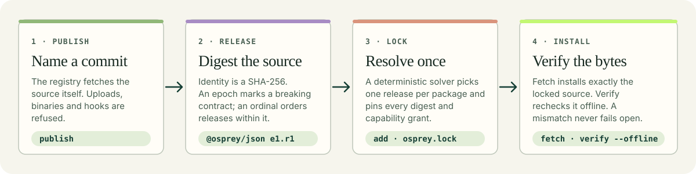

<p align="center">
  <a href="https://nimblesite.github.io/osprey-packages/"></a>
</p>

<p align="center">
  <a href="https://nimblesite.github.io/osprey-packages/"><b>Browse packages</b></a> ·
  <a href="docs/specs/ecosystem/PackageManagement.md">Spec</a> ·
  <a href="docs/plans/package-manager.md">Plan</a> ·
  <a href="https://www.ospreylang.dev/docs/package-manager/">Guide</a> ·
  <a href="https://github.com/Nimblesite/osprey">Osprey language</a>
</p>

## What this is

The package manager for [Osprey](https://www.ospreylang.dev/). A project lists its dependencies in `osprey.toml`. The `osprey-pkg` client resolves them once into `osprey.lock` and installs exactly the source that lock names.

A package is **Osprey source, identified by its SHA-256 digest**. A version is not a number its author chose. Everything is written in Osprey: the client, the registry server, the website and the tests.

<p align="center">
  
</p>

<table>
  <tr>
    <td width="50%" valign="top">
      <h3>🔒 Digests, not version ranges</h3>
      There is no SemVer. A release is <code>e1.r4</code>: an <b>epoch</b> says when the contract broke, and an <b>ordinal</b> orders releases within it. The lock pins digests, so the same lock always installs the same bytes.
    </td>
    <td width="50%" valign="top">
      <h3>📦 Source only</h3>
      Packages hold Osprey source and declared data. Native binaries, object files and install hooks are refused. A package that needs the system declares a <b>capability</b>, and the lock records which ones you granted.
    </td>
  </tr>
  <tr>
    <td width="50%" valign="top">
      <h3>🗂️ A registry is a folder</h3>
      The first registry is an Osprey server over a plain directory, with no database. Anyone can run one on any host and point a client at it. The hosted registry (Cloud Run with Supabase) serves the same API.
    </td>
    <td width="50%" valign="top">
      <h3>🛡️ Fails closed</h3>
      A digest mismatch, a malformed release or a failed check never installs anything. Package integrity is the product: hashes, locks and trust checks never fail open.
    </td>
  </tr>
</table>

## What's in the repo

| Part | Where | What it does |
|---|---|---|
| **Client** | [`src/manager/cli`](src/manager/cli) | `osprey-pkg`: `add`, `remove`, `update`, `fetch`, `verify`, `use`, `publish` and `build` |
| **Registry** | [`src/manager/api`](src/manager/api) | The folder registry and the hosted API listener |
| **Core** | [`src/manager/core`](src/manager/core) (with `host`, `manifest` and `resolver`) | Names, canonical JSON, SHA-256, capability surfaces, the TOML parser and the deterministic solver |
| **Website** | [`src/manager/web`](src/manager/web) | The registry site, compiled to WASM and rendered to static pages |
| **Editor** | [`src/manager/web/editor`](src/manager/web/editor) | The VS Code package workspace |
| **Model** | [`src/manager/schemas/package-registry.td`](src/manager/schemas/package-registry.td) | The canonical domain model, in [typeDiagram](https://typediagram.dev/) |

The [manager README](src/manager/README.md) covers each part in depth.

## Build and test

You need `make`, `curl` and a POSIX shell. `make` downloads the released Osprey toolchain pinned in [`scripts/osprey-toolchain.sh`](scripts/osprey-toolchain.sh) into `target/osprey` (the compiler, its runtime and the published `@osprey` packages) and checks its SHA-256.

```sh
make build            # osprey-pkg, the folder-registry server and the editor WASM
make ci               # every suite once under its app's memory strategy, then the website check in Chromium
make registry-serve   # serve the @osprey packages on http://127.0.0.1:8787
make help             # every target
```

CI runs three phases, once each. Phase 1 builds the client and the hosted fixture site. Phase 2 runs every suite once with line coverage, under its app's one memory strategy: GC for the client, ARC for the folder registry, the hosted API and the WASM editor and website. Phase 3 gates the merged coverage against [`scripts/coverage-thresholds.json`](scripts/coverage-thresholds.json), which only goes up.

## Specs

[Package management](docs/specs/ecosystem/PackageManagement.md) · [registry trust and discovery](docs/specs/ecosystem/PackageRegistryTrustAndDiscovery.md) · [domain model](docs/specs/ecosystem/PackageDomainModel.md) and [invariants](docs/specs/ecosystem/PackageDomainInvariants.md) · [evidence and discovery](docs/specs/ecosystem/PackageEvidenceAndDiscovery.md) · [deployment and ownership](docs/specs/ecosystem/PackageRegistryDeploymentAndOwnership.md) · [organization governance](docs/specs/ecosystem/OrganizationPackageGovernance.md) · [research basis](docs/specs/ecosystem/PackageResearchBasis.md)

## Relationship to Osprey

This repository moved out of [ospreylang](https://github.com/Nimblesite/osprey) in the [repository split](https://github.com/Nimblesite/osprey/blob/main/docs/plans/repo-split.md). Ospreylang's CI runs `make canary` here with each new compiler. When a change here needs a compiler fix, the fix lands in ospreylang and ships in a release. Then the pinned tag here is bumped.

<sub>MIT licensed. See [LICENSE](LICENSE).</sub>
