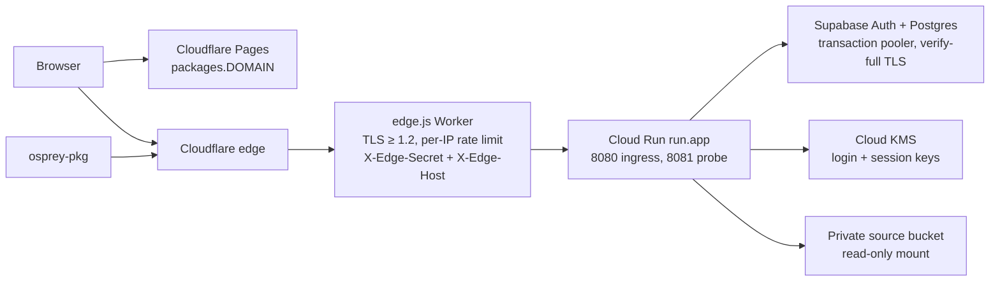

# Registry operations

Deploy from a clean `main` only: `make deploy STEP=release` applies the infrastructure and the private registry migration, deploys the API and website, and checks production (production is the only environment). Before the first run the owner sets the monthly budget and creates the GitHub OAuth app (homepage: the website; callback: `https://<supabase-ref>.supabase.co/auth/v1/callback`), with its ID and secret in `deploy.env`. Cloudflare stays on the free plan. Setting up the core `@osprey` account: [docs/DEPLOY.md](../../../docs/DEPLOY.md). This file says what the pieces are. Shape: Cloudflare → Cloud Run → Supabase ([Registry Deployment and Ownership](../../../docs/specs/ecosystem/PackageRegistryDeploymentAndOwnership.md) `[PACKAGE-HOSTED-TOPOLOGY]`).

| Path | What |
| --- | --- |
| `terraform/` | Every GCP and Cloudflare resource. Remote state lives in `gs://<project>-osprey-registry-tfstate`, one prefix per environment. `make _registry-infra-check` validates it with no backend (run in CI) |
| `cloudflare/edge.js` | Transport-only Worker: HTTPS redirect, TLS ≥ 1.2 (426), per-IP rate limit (429), overwrite `X-Edge-Secret` and `X-Edge-Host`, fetch the `run.app` origin |
| `supabase/roles.sql` | Restricted runtime logins and their exact column grants; idempotent, passwords through `\getenv` |
| `supabase/supabase-root-2021.crt` | Supabase's public root CA (SHA-256 `700723581420dd1ac98fd7e9ac529f0ef210eadcaf87fc868a3ad7d114c2f3b7`), mounted as `/run/catalog-ca/ca.pem` |
| `deploy.sh` | The operator command behind `make deploy` |
| `Dockerfile` | Native linux/amd64 API image, non-root, PostgreSQL client 17 |

## Generated, never typed

Terraform generates the edge secret and every database login password, and writes three pinned Secret Manager versions that Cloud Run mounts read-only:

- `/run/registry/runtime.json`: `apiHost`, `websiteOrigin`, `contentHost`, `edgeSecret`, `supabaseOrigin`, `supabasePublishableKey`, `loginKmsKey`, `sessionKmsKey`.
- `/run/catalog-service/pg_service.conf`: `[catalog]`, `[login]`, `[session-issuer]`, `[session-runtime]` and `[session-revoker]`, each a distinct login on the transaction pooler (port 6543).
- `/run/catalog-ca/ca.pem`: the Supabase root CA. The API connects with `sslmode=verify-full`.

The only operator-held credentials are the Cloudflare tokens, the Supabase access token and the GitHub OAuth client. `deploy.sh` generates the Supabase owner password and stores it in Secret Manager as `osprey-registry-<env>-db-owner`; it is used only for migrations. Terraform provisions a dedicated migration build account, a private staging bucket with one-day object expiry, and logging access. The operator submitting the migration needs permission to act as that service account. The database step removes the historical direct owner-secret grant from the default Compute service account before submitting the build. Read access to the Terraform state bucket is secret access.

## Database logins [PACKAGE-OWNERSHIP-RLS]

`roles.sql` runs after the DataProvider migration. Every login is `NOSUPERUSER NOBYPASSRLS NOINHERIT` with schema `USAGE`, and `anon`/`authenticated` lose all access to `registry`. `src/manager/api/tests/live` proves the same grants:

| Login | Grants |
| --- | --- |
| `registry_catalog_reader` | `SELECT` on `public_catalog` |
| `registry_login_runtime` | `pending_logins`: column `INSERT`/`SELECT` on the four flow columns, `DELETE` |
| `registry_session_issuer` | identity columns of `auth_bindings`/`principals`; `INSERT` session columns, `SELECT(id)` on `browser_sessions` |
| `registry_session_runtime` | identity columns; `SELECT` session columns, `UPDATE(last_used_at, token_envelope, refresh_id, refresh_started_at)` |
| `registry_session_revoker` | `SELECT(id, principal_id)`, `SELECT(id, credential_epoch)`; `SELECT`/`UPDATE(revoked_at, token_envelope)` on `browser_sessions` |

`catalog.sql` then creates the public catalog's one writer: `registry_catalog_writer` is `NOLOGIN` with `SELECT`/`INSERT`/`UPDATE` on `public_catalog` alone, owns the `SECURITY DEFINER` `registry.refresh_public_catalog()` (no `PUBLIC` execute) and refreshes row 1 with a one-hour lifetime at apply. `catalog-schedule.sql` has `pg_cron` repeat it every ten minutes, so the catalog never lapses into `503 registry.not-ready`; an empty registry is the valid `{"packages":[]}`.

## Releases [PACKAGE-HOSTED-RELEASE]

`.github/workflows/deploy.yml` (dispatched by `make deploy`, or by hand from the Actions tab) reruns CI at the exact SHA. It then builds the image from that commit, pushes `api:<sha>` and rolls Cloud Run to the resolved `@sha256` digest. The website is built as a content-addressed archive (`make _registry-website-archive`) and uploaded with Pages Direct Upload. Terraform creates the service from the first CI-built digest and then ignores image changes. Rolling back means redeploying an older digest: `gcloud run services update osprey-registry-<env> --image=<repo>/api@sha256:…`.

Migrations are explicit: `make deploy STEP=database`, never at build or startup.

## Edge credential rotation [PACKAGE-HOSTED-EDGE]

`terraform apply -replace=random_password.edge_secret` writes the new secret to the Worker and to a new runtime config version together, so expect a few seconds of 403s while the revision rolls. For a zero-403 cutover, first deploy a runtime config with `edgeSecretOverlap: { secret: <old>, expiresAtUnixSeconds: <deadline> }`. The API accepts the retiring value only in the 15 minutes before that deadline.

## Local rehearsals

- `make _registry-migration-check`: the migration applied twice on disposable PostgreSQL.
- `make _registry-hosted-image-check`: the image with mounted config on both ports (needs Docker).
- `make _registry-website-check` / `make _registry-integration-check`: the packaged site in Chromium, against a fixture API and against the real API on PostgreSQL.

Public writes stay disabled until the Registry Deployment and Ownership spec's conformance table passes against production.

## Publication scan worker

The image includes the one-shot command `/usr/local/bin/registry-scan-once` for a separately provisioned worker identity [PACKAGE-SECURITY-SCAN-VERDICT]. The API listener starts by default. The worker claims one pending submission or accepts its UUID as an argument. Mount the scanner’s PostgreSQL service file at `/run/registry-scan-db/pg_service.conf`, its PostgreSQL root CA at `/run/catalog-ca/ca.pem`, its pinned NAP configuration (`configId`, `agentRevision`, `apiKey`) at `/run/registry-scan/agent.json`, and immutable canonical bundles read-only at `/run/registry-quarantine/<submission UUID>/<sha256 hex>.json`. A missing mount, invalid digest or agent failure leaves the submission pending. A successful empty-queue run performs no remote scan. Terraform declares separate collector and scanner identities. The collector has create-only access to the private quarantine bucket. Its separate `collector-db` service file contains only the `registry_publication_collector` login. The collector identity can read this file and the database CA. The scanner can read that bucket and its own database and agent credentials. The database migration step provisions its password separately from the API service file.

To enable the one-shot job from a main deployment, provision the tool-free NAP configuration, add its JSON as a version of the `osprey-registry-production-scan-agent` Secret Manager secret, and set `TF_VAR_scan_agent_secret_version` to that numeric version for infrastructure deployments. Set `agentRevision` to `sha256:` followed by the lowercase SHA-256 of the exact response body from `GET /api/v1/configs/{configId}`. Save the response directly to a file, review the prompt, model, disembodied mode and empty tools list, then hash those bytes with `shasum -a 256`. The worker checks that digest before and after each scan. The database deployment copies only that configuration ID and revision from the same numbered secret version into the forced-RLS policy table. An empty Terraform version disables the job and clears the database selection during deployment. Once enabled, the collector can invoke the job after committing a frozen submission. The hosted signed-intent collector still needs implementation.

### Appointing a release reviewer

After the person signs in, the database owner can call `registry.appoint_release_reviewer(person, verified_issuer, github_account)` with the registry principal UUID, the configured identity issuer and the numeric GitHub account ID. Verify the returned UUID equals the intended principal. A NULL result means the identity checks failed. Repeating a successful appointment returns the same UUID. To withdraw review permission, the owner calls `registry.remove_release_reviewer(person)`; this also works after the identity has been suspended or its binding revoked.
