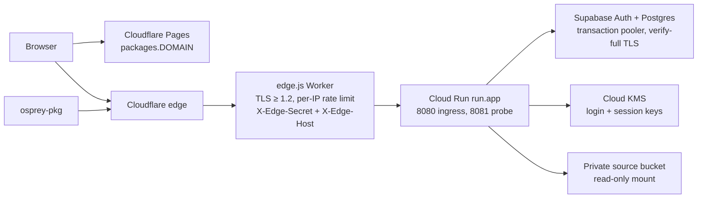

# Registry operations

Deploy with [docs/DEPLOY.md](../../../docs/DEPLOY.md): `make deploy` (production is the only environment). This file says what the pieces are. Shape: Cloudflare → Cloud Run → Supabase ([Registry Deployment and Ownership](../../../docs/specs/ecosystem/PackageRegistryDeploymentAndOwnership.md) `[PACKAGE-HOSTED-TOPOLOGY]`).

| Path | What |
| --- | --- |
| `terraform/` | Every GCP and Cloudflare resource. Remote state lives in `gs://<project>-osprey-registry-tfstate`, one prefix per environment. `make _registry-infra-check` validates it with no backend (run in CI) |
| `cloudflare/edge.js` | Transport-only Worker: HTTPS redirect, TLS ≥ 1.2 (426), per-IP rate limit (429), overwrite `X-Edge-Secret` and `X-Edge-Host`, fetch the `run.app` origin |
| `supabase/roles.sql` | Restricted runtime logins and their exact column grants; idempotent, passwords through `\getenv` |
| `supabase/supabase-root-2021.crt` | Supabase's public root CA (SHA-256 `700723581420dd1ac98fd7e9ac529f0ef210eadcaf87fc868a3ad7d114c2f3b7`), mounted as `/run/catalog-ca/ca.pem` |
| `deploy.sh` | The operator command behind `make deploy` |
| `Dockerfile` | Native linux/amd64 API image, non-root, PostgreSQL client 17 |

## Generated, never typed

Terraform generates the edge secret and every database login password, and writes three pinned Secret Manager versions that Cloud Run mounts read-only:

- `/run/registry/runtime.json`: `apiHost`, `websiteOrigin`, `contentHost`, `edgeSecret`, `supabaseOrigin`, `supabasePublishableKey`, `loginKmsKey`, `sessionKmsKey`.
- `/run/catalog-service/pg_service.conf`: `[catalog]`, `[login]`, `[session-issuer]`, `[session-runtime]` and `[session-revoker]`, each a distinct login on the transaction pooler (port 6543).
- `/run/catalog-ca/ca.pem`: the Supabase root CA. The API connects with `sslmode=verify-full`.

The only operator-held credentials are the Cloudflare tokens, the Supabase access token and the GitHub OAuth client. `deploy.sh` generates the Supabase owner password and stores it in Secret Manager as `osprey-registry-<env>-db-owner`; it is used only for migrations. Read access to the Terraform state bucket is secret access.

## Database logins [PACKAGE-OWNERSHIP-RLS]

`roles.sql` runs after the DataProvider migration. Every login is `NOSUPERUSER NOBYPASSRLS NOINHERIT` with schema `USAGE`, and `anon`/`authenticated` lose all access to `registry`. `src/manager/database-tests/live` proves the same grants:

| Login | Grants |
| --- | --- |
| `registry_catalog_reader` | `SELECT` on `public_catalog` |
| `registry_login_runtime` | `pending_logins`: column `INSERT`/`SELECT` on the four flow columns, `DELETE` |
| `registry_session_issuer` | identity columns of `auth_bindings`/`principals`; `INSERT` session columns, `SELECT(id)` on `browser_sessions` |
| `registry_session_runtime` | identity columns; `SELECT` session columns, `UPDATE(last_used_at, token_envelope, refresh_id, refresh_started_at)` |
| `registry_session_revoker` | `SELECT(id, principal_id)`, `SELECT(id, credential_epoch)`; `SELECT`/`UPDATE(revoked_at, token_envelope)` on `browser_sessions` |

## Releases [PACKAGE-HOSTED-RELEASE]

`.github/workflows/deploy.yml` (dispatched by `make deploy`, or by hand from the Actions tab) reruns CI at the exact SHA. It then builds the image from that commit, pushes `api:<sha>` and rolls Cloud Run to the resolved `@sha256` digest. The website is built as a content-addressed archive (`make _registry-website-archive`) and uploaded with Pages Direct Upload. Terraform creates the service from the first CI-built digest and then ignores image changes. Rolling back means redeploying an older digest: `gcloud run services update osprey-registry-<env> --image=<repo>/api@sha256:…`.

Migrations are explicit: `make deploy ENV=<env> STEP=database`, never at build or startup.

## Edge credential rotation [PACKAGE-HOSTED-EDGE]

`terraform apply -replace=random_password.edge_secret` writes the new secret to the Worker and to a new runtime config version together, so expect a few seconds of 403s while the revision rolls. For a zero-403 cutover, first deploy a runtime config with `edgeSecretOverlap: { secret: <old>, expiresAtUnixSeconds: <deadline> }`. The API accepts the retiring value only in the 15 minutes before that deadline.

## Local rehearsals

- `make _registry-migration-check`: the migration applied twice on disposable PostgreSQL.
- `make _registry-hosted-image-check`: the image with mounted config on both ports (needs Docker).
- `make _registry-website-check` / `make _registry-integration-check`: the packaged site in Chromium, against a fixture API and against the real API on PostgreSQL.

Public writes stay disabled until the Registry Deployment and Ownership spec's conformance table passes against production.
